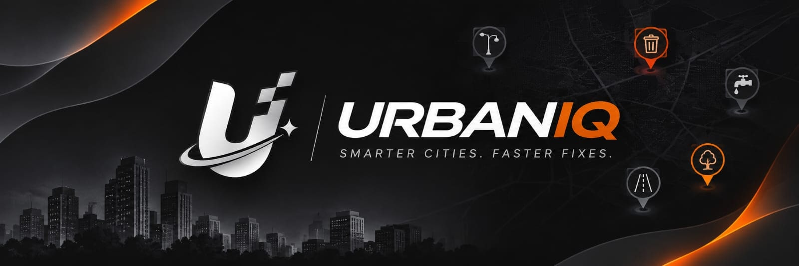
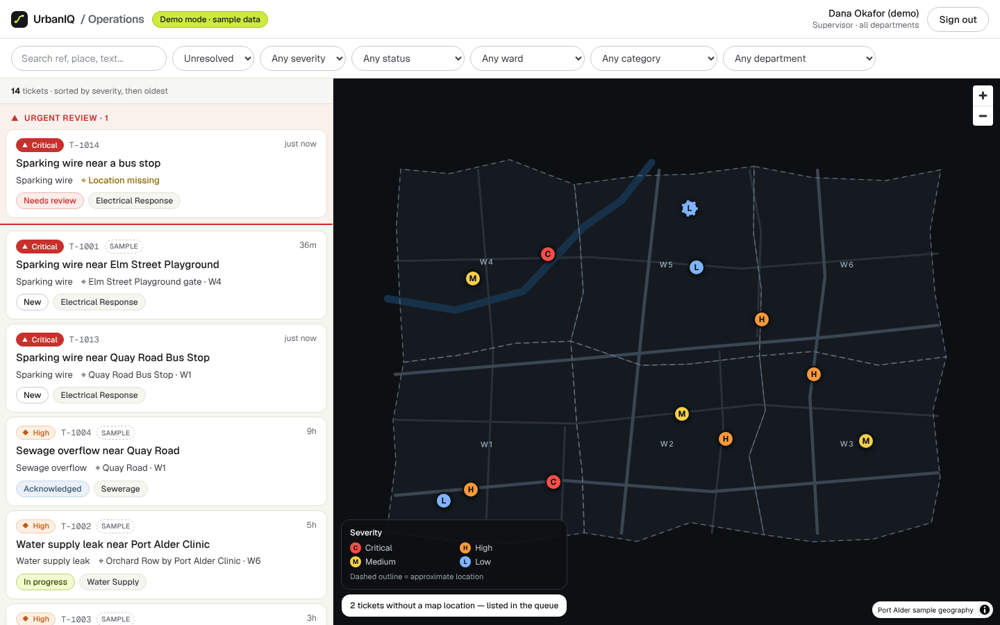
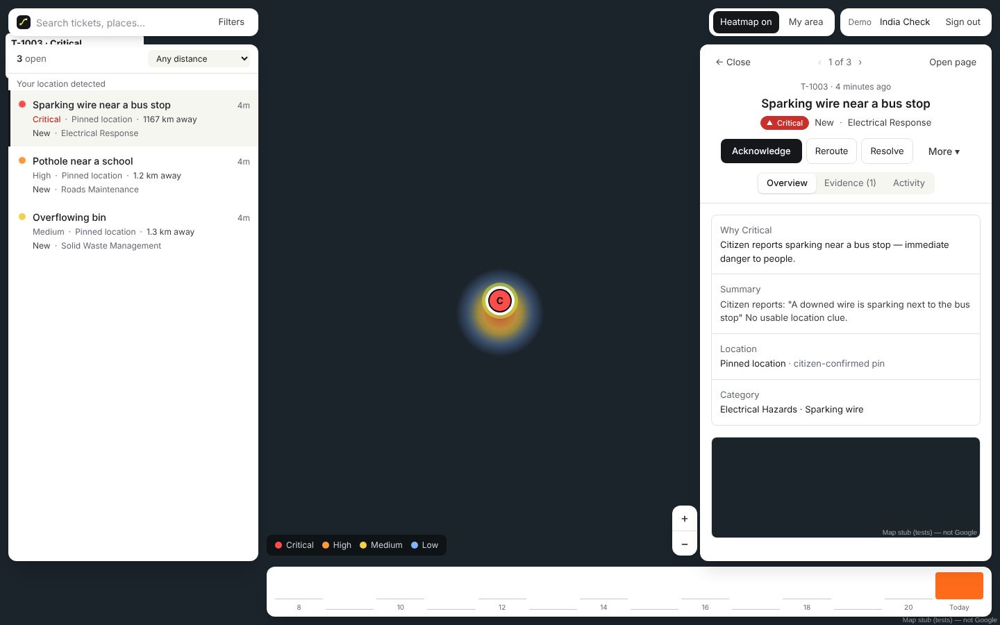
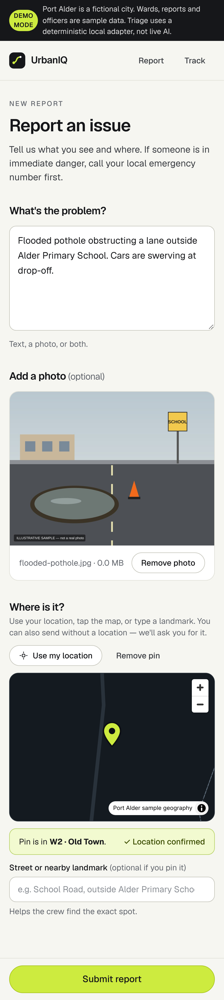
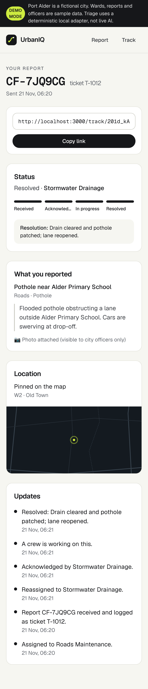
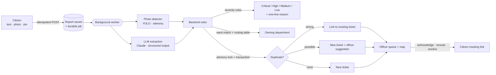

<p align="center">
  
</p>

<h3 align="center">Smarter cities. Faster fixes. 🇮🇳 Built for India.</h3>

<p align="center">
  AI-assisted municipal complaint triage: from a citizen's photo or sentence to a routed, prioritised ticket in seconds,<br/>
  with officers in control of every decision.
</p>

<p align="center">
  
  
  
  
  
  
  
</p>

<p align="center">
  <a href="#-quick-start">Quick start</a> ·
  <a href="#-how-it-works">How it works</a> ·
  <a href="#-features">Features</a> ·
  <a href="#-live-integrations">Integrations</a> ·
  <a href="#-deploy-on-dokploy">Deploy</a> ·
  <a href="#-verification">Verification</a> ·
  <a href="#-project-structure">Structure</a>
</p>

---

## ✨ Why UrbanIQ

Cities receive thousands of complaints that arrive as free text, blurry photos and vague locations ("near the
school"). Officers then spend their mornings re-typing, guessing the owner and hunting for duplicates.

**UrbanIQ turns every report into an actionable ticket:**

| Citizen sends | UrbanIQ produces |
| --- | --- |
| *"Flooded pothole blocking a lane outside Alder Primary School"* + 📷 + 📍 | **High** · Roads › Pothole · *"Citizen reports a water-filled pothole obstructing a lane near Alder Primary School."* · Ward 2 · **Roads Maintenance** |
| *"Power line down and sparking next to a bus stop!"* (no location) | **Critical** · pinned in **Urgent review** · automatic question: *"Where exactly is the sparking wire?"* |
| 📷 only, of an overflowing bin | Saved instantly · photo detector suggests *garbage (87%)* · asks for location · stays visible to officers |
| A second report about the same pothole | **Auto-linked** to the existing ticket. Each citizen keeps their own private tracking link |

> [!NOTE]
> **India only by default** (`SERVICE_REGION=IN`). Pins, device locations and Google Places search are restricted to India, and the server rejects reports located elsewhere.
> For offline demos there is also **Port Alder**, a fictional municipality. All wards, streets, reports and officers are
> clearly labelled sample data, and the sample wards sit in the open ocean so they can't be mistaken for a real city.

## 📸 Screenshots

| Officer workspace: priority queue + ward map | Ticket detail: evidence, reason, next action |
| --- | --- |
|  |  |

| Citizen report (mobile) | Citizen tracking (mobile) |
| --- | --- |
|  |  |

## 🧭 How it works



**The AI extracts evidence; the backend makes the decisions.**

* The models never assign departments, change records or dispatch crews.
* Severity comes from fixed, reviewable rules: *Critical* means immediate danger to people, *High* a significant hazard, obstruction or outage, *Medium* an active issue in a public space, and *Low* a localised issue.
* Every reason names its evidence source. A photo of a wire alone can never prove it is live.

## 🚀 Features

**For citizens**
- 📝 Report with text, a photo, or both. Photos are validated by content, re-encoded and stripped of EXIF/GPS.
- 📍 Choose a location with Google Places search, by dropping or dragging a pin, or with *Use my location*. If maps or location permission fail, typing a landmark always works.
- ✅ Explicit location confirmation before submission. The draft is saved locally if anything fails.
- 🔗 A private, unguessable tracking link with a status timeline, department, resolution note, answers to the city's questions, and location corrections.

**For officers**
- 📍 **Your area first.** The dashboard detects where the officer is working from (browser location, never sent to the server), centres the map there, shows each ticket's distance and filters to *within 2 / 5 / 10 / 25 km of me*.
- 🔥 **Heatmap.** A severity-weighted heatmap shows where problems cluster; it can be toggled off.
- 🗂️ The priority queue sorts Critical → Low, then oldest first. **Urgent review** is pinned on top, and tickets without coordinates stay visible.
- 🗺️ A dark ward map synced with the queue: selecting a row highlights its pin, and clicking a pin opens the ticket with its ward and severity.
- 🔎 Evidence side by side: the original complaint, what the citizen said, what the photo shows, detector boxes, risk factors, conflicts, and linked reports.
- ⚙️ Acknowledge → In progress → Resolved, plus Needs review and Waiting for details. Reroutes and severity changes require a reason.
- 🧾 A full audit trail with actor, timestamp and before/after values. Internal notes are never shown to citizens.
- 🔁 Duplicate and recurrence suggestions with plain-English explanations, which the officer confirms or dismisses.

**Under the hood**
- 🧱 A durable Postgres job queue (`SKIP LOCKED`, bounded retries with backoff, stale-lock reclaim). Officers can retry failed AI processing.
- 🛡️ Server-side auth and per-department permissions, private photo storage (local or S3-compatible), rate limits, same-origin checks, and safe error messages.
- 🧪 A demo mode with a deterministic triage adapter, so the whole flow runs offline with no API keys.

## ⚡ Quick start

Requires Node 20+ and Docker (for Postgres).

```bash
cp .env.example .env            # set APP_SECRET: openssl rand -hex 32
```

```bash
docker compose up -d db
```

```bash
npm install
```

```bash
npx prisma migrate deploy && npm run db:seed
```

```bash
npm run dev
```

Open **http://localhost:3000**. For production, use `npm run build && npm start`.

### Demo sign-in

| Account | Role |
| --- | --- |
| `supervisor@civicflow.demo` | Supervisor, all departments |
| `roads@civicflow.demo` | Roads Maintenance officer |
| `electrical@civicflow.demo` | Electrical Response officer |

The password for all three is **`civicflow-demo`**. Demo accounts only work in demo mode.
`npm run db:seed` also prints tracking links for the sample reports.

## 🔌 Live integrations

<details>
<summary><b>🤖 Claude triage (optional)</b></summary>

```env
CIVICFLOW_MODE="production"
ANTHROPIC_API_KEY="sk-ant-..."
AI_MODEL="claude-opus-5-5"
AI_EFFORT="low"
```

Text and photo are sent with a frozen system prompt. The model returns structured output, which the server validates with Zod.
Without a key, the built-in rule-based classifier is used instead (no AI calls, no warnings).
Refusals, malformed output and timeouts never lose a report. The report is kept, retried with
backoff, and finally filed for review with a keyword-based provisional classification.
</details>

<details>
<summary><b>👁️ YOLO photo analysis: AI Civic Guardian checkpoint (advisory)</b></summary>

A private CPU FastAPI service in [`vision/`](vision/). It maps detector classes to five issue types:
`broken_streetlight`, `water_leak`, `fallen_tree`, `garbage` and `pothole`. For each, it returns the label, confidence and bounding box, which officers see as advisory evidence.

* Severity rules and officer edits are never overridden by the detector.
* If the detector is missing, offline or inconclusive, triage continues with text + location.
* Photo-only reports with insufficient evidence go to **Needs review**.

> [!WARNING]
> **The weights are not bundled.** The source repository has no licence file, and the checkpoint metadata declares
> Ultralytics AGPL‑3.0. Clear reuse before deploying. [vision/README.md](vision/README.md) records the checkpoint
> verification (sha256, class map) and gives Dokploy deployment steps.

```env
VISION_URL="http://urbaniq-vision:8000"   # private network only
VISION_TOKEN="…"                          # same value on both services
```
</details>

<details>
<summary><b>🗺️ Google Maps + Places</b></summary>

1. Enable **Maps JavaScript API** and **Places API (New)**.
2. Create a **browser key**:
   * **Application restrictions:** HTTP referrers, your UrbanIQ origin(s) only.
   * **API restrictions:** those two APIs only.
3. Create a vector **Map ID**.
4. Set both values **before** `npm run build` (they are inlined into the bundle):

```env
NEXT_PUBLIC_GOOGLE_MAPS_API_KEY="…"
NEXT_PUBLIC_GOOGLE_MAPS_MAP_ID="…"
```

**Ward matching**

* The server matches confirmed coordinates to the municipality's ward boundaries (`WARDS_GEOJSON_PATH`; the sample wards are the default).
* Out-of-area and approximate locations go to review.

**Google terms**

* UrbanIQ stores only the citizen's own data (their words and the pin they confirmed) and the Google **Place ID**.
* Place names are fetched live for officers and shown with attribution.
</details>

## 🐳 Deploy on Dokploy

UrbanIQ ships a production [`Dockerfile`](Dockerfile) and a [`docker-compose.dokploy.yml`](docker-compose.dokploy.yml) for Dokploy's **Compose** deployment type. The compose file defines the app, PostgreSQL and the optional private vision service.

**Option A: Compose (recommended, includes Postgres)**

1. Dokploy → *Create Service* → **Compose** → connect this repository, branch `main`, compose path `./docker-compose.dokploy.yml`.
2. In **Environment**, set at least:
   ```env
   POSTGRES_PASSWORD=change-me
   APP_SECRET=<openssl rand -hex 32>
   APP_BASE_URL=https://urbaniq.example.gov
   CIVICFLOW_MODE=production      # or demo (demo logins + labels)
   SEED_DEMO_DATA=false           # true loads the fictional sample city (it resets data!)
   NEXT_PUBLIC_GOOGLE_MAPS_API_KEY=   # optional, build-time
   NEXT_PUBLIC_GOOGLE_MAPS_MAP_ID=    # optional, build-time
   ```
3. Under **Domains**, add your domain for service **`app`**, port **3000**, with HTTPS on.
4. Deploy.

**Option B: Application (Dockerfile) + managed Postgres**

1. Create a Dokploy **PostgreSQL** database. Then create an **Application** from this repo with build type **Dockerfile**.
2. Set `DATABASE_URL` to the internal connection string, along with the variables above. Pass the `NEXT_PUBLIC_*` values as **build arguments**.
3. Mount a volume at `/app/storage` (private photo uploads), or set `STORAGE_DRIVER=s3` and the `S3_*` variables.
4. Add a domain on port 3000.

**Production (real officer accounts, AI optional)**

No AI key is needed. Without `ANTHROPIC_API_KEY`, reports are triaged by the built-in rule-based classifier; add a key at any time and Claude takes over automatically (`AI_PROVIDER=rules` keeps AI off even with a key).
On start, production mode removes the demo officer accounts and any seeded sample tickets (real citizen reports are never touched).

Set `CIVICFLOW_MODE=production`, redeploy, then open the app container's terminal in Dokploy and run:

```bash
/app/docker/entrypoint.sh create-officer --email ana@city.gov --name "Ana Diaz" --role SUPERVISOR --password 'a-long-password'
```

```bash
/app/docker/entrypoint.sh create-officer --email sam@city.gov --name "Sam Lee" --role OFFICER --department ROADS --password 'another-long-password'
```

Department codes are `ROADS`, `WASTE`, `WATER`, `LIGHTS`, `ELEC`, `TREES`, `DRAIN`, `SEWER` and `HARBOUR`. Departments and default routing rules are created automatically on every start; the step is idempotent. To change them, edit `prisma/reference-data.ts`.

**Removing the sample data**

```bash
/app/docker/entrypoint.sh reset-data --yes
```

This deletes every report, ticket and photo, and keeps departments, routing rules and officer accounts.

**What the container does on start**

* Runs `prisma migrate deploy`, unless `RUN_MIGRATIONS=false`.
* Optionally seeds demo data.
* Starts the server with the background triage worker built in.
* Health check: `GET /api/health` (app + database).
* Other commands: `docker run … worker`, `… migrate` and `… seed`.

**Photo analysis:** enable the `vision` profile (`COMPOSE_PROFILES=vision`) only after the YOLO weights are cleared for reuse. It never gets a public domain. See [vision/README.md](vision/README.md).

## ✅ Verification

| Suite | Command | Result |
| --- | --- | --- |
| Unit + integration (severity order, ward routing, duplicate linking under concurrency, access control, vision handling) | `npm test` | **43 / 43** |
| Core UI flows: pothole → High/Roads, duplicate linking, Critical wire + urgent review, photo-only, officer lifecycle, access control, mobile | `node verification/e2e.mjs` | **27 / 27** |
| Maps + vision UI flows: all five detector types, no-vision model, location permission denied, ward match, out-of-area, Maps unavailable, pin ↔ queue sync | `node verification/e2e-maps-vision.mjs` | **25 / 25** |
| India profile: region-restricted search, out-of-India rejection, officer location + distance filter, heatmap | `node verification/e2e-india.mjs` | **15 / 15** |
| Vision service (fake model): mapping, auth, missing model, checksum pin, class-map mismatch | `cd vision && pytest -q` | **6 / 6** |
| Typecheck, lint, production build | `npm run typecheck && npm run lint && npm run build` | ✔ |

> [!IMPORTANT]
> The maps + vision UI suite runs against **stubs** of the Google Maps JS API and the vision service. It verifies UrbanIQ's
> integration code, not live Google Maps or the real YOLO model. Live Claude triage is also unverified without credentials.

## 🗂️ Project structure

```
src/app            Pages and API routes (reports, track, officer, auth, wards)
src/lib            Pipeline · severity rules · routing · duplicate matching · vision client · wards · auth · storage
src/components     Citizen form & tracking · officer workspace · Google / offline maps
prisma/            Schema, migrations, seed (sample city)
vision/            Private YOLO inference service (Dockerfile, tests, Dokploy notes)
data/              Sample geography for the fictional city of Port Alder
verification/      Playwright UI suites and test stubs
docs/              Brand assets and screenshots
```

## 🧰 Tech stack

**Next.js 15** (App Router) · **TypeScript** · **Tailwind CSS 4** · **PostgreSQL** · **Prisma** · **Zod** ·
**Anthropic SDK** · **FastAPI + Ultralytics** · **Google Maps JS API / Places** · **MapLibre GL** (offline fallback) ·
**sharp** · **Vitest** · **Playwright**

---

<p align="center">
  <br/>
  <sub><b>UrbanIQ</b>: built for faster, fairer city services. Hackathon prototype; all demo data is fictional.</sub>
</p>
